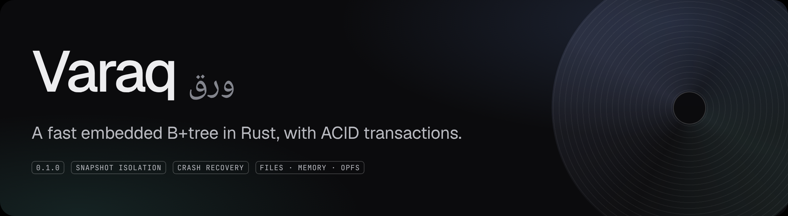
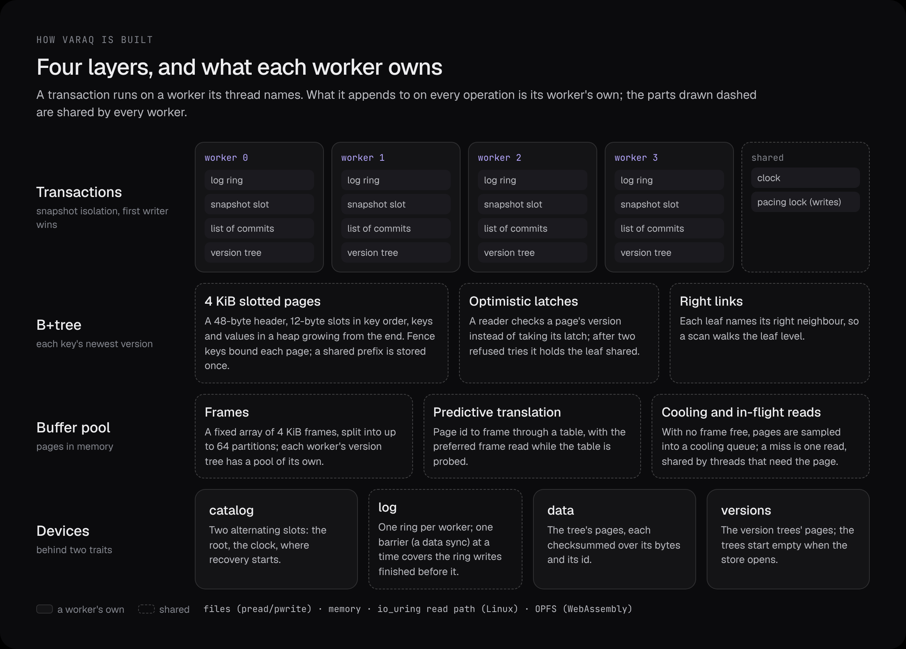
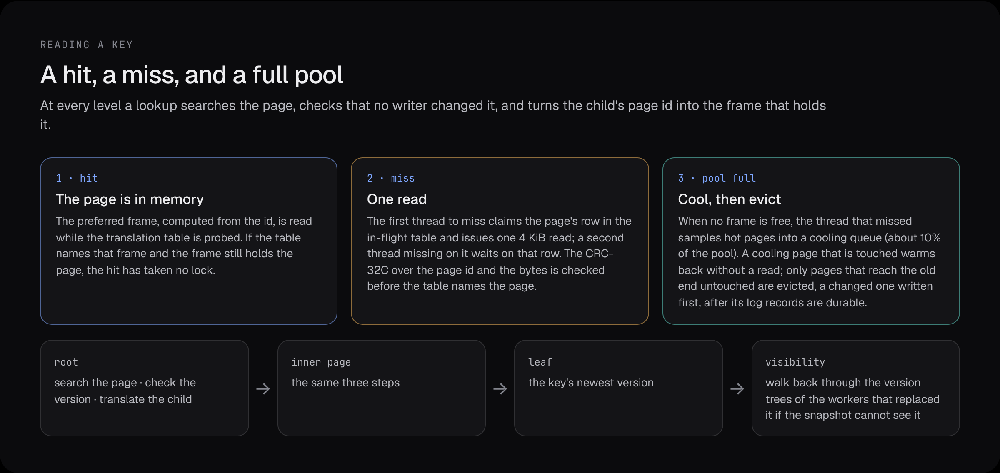
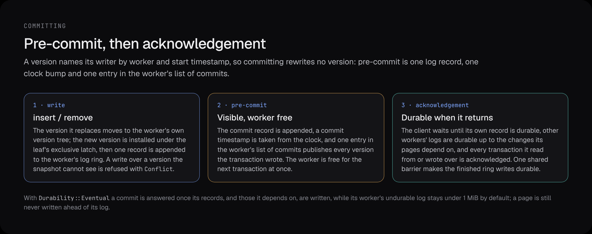
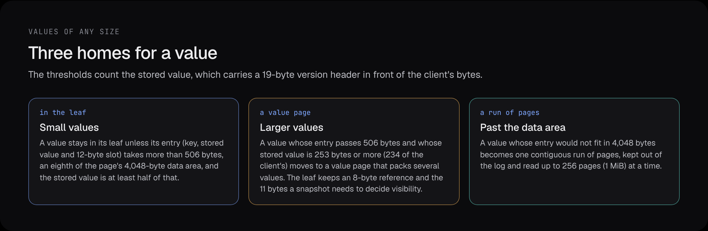

<p align="center"></p>

# Varaq

An embedded, transactional key-value store for Rust: a B+tree of 4 KiB pages that keeps the pages
in use in memory, reads the rest from its files, and runs every transaction under snapshot
isolation.

It is a library, not a server. You link it into your program, give it somewhere to keep its pages
(memory, ordinary files, or the browser's private file system) and call it from your own threads.
There is no async runtime to adopt and no background process to manage.

```toml
[dependencies]
varaq = "0.1"
```

> **Status: 0.1, early.** The API and the on-disk format will change before 1.0. Pin a version
> and expect to recreate stores across upgrades.

The [announcement](https://unchanged.dev/blog/introducing-varaq.html) walks through the design
layer by layer, with the first measurements; [unchanged.dev/varaq](https://unchanged.dev/varaq/) is
the project page.

## What it does

- **Reads check versions.** A lookup reads each page under an optimistic latch: it notes the
  page's version, copies what it needs and checks the version again, retrying if a writer moved
  it. After two refused tries it holds the leaf shared.
- **Larger than memory.** When the pool is full, pages sampled at random cool, and only those left
  untouched are evicted. A page that is not in memory costs one 4 KiB read, shared by every thread
  that misses on it; when no frame is free, the thread that missed first makes room, which can
  mean writing a changed page back.
- **Transactions.** Snapshot isolation for every transaction; of two that write the same key, the
  first wins and the second is refused with `Error::Conflict` when it writes. Write skew is
  possible: snapshot isolation is weaker than serializability.
- **Durable by default.** A commit returns once its log record is on the device, and a store
  reopens after a crash with every acknowledged commit in place.
- **Correct or refuse.** Every data and version page is checked against a CRC-32C over its bytes
  and its page id when it is read, and log records carry their own. A page that fails is reported
  as an error and never served as data (recovery rebuilds it from the log when the log holds its
  image), and so is a store whose creation never finished. A log record that fails its check ends
  that worker's log at that point, as a torn tail does.
- **Runs where your code runs.** Linux, macOS and other Unix systems over ordinary files; an
  optional `io_uring` read path on Linux; the browser through WebAssembly and OPFS.

## Quick start

### A tree in memory

The B+tree on its own: ordered keys and values as bytes.

```rust
use varaq::tree::Tree;
use varaq::tree::scan::Step;

fn main() -> Result<(), varaq::Error> {
    // A buffer pool of 1,024 pages (4 KiB each); the pages it evicts go to an in-memory store.
    let tree = Tree::with_capacity(1_024)?;

    tree.insert(b"apple", b"red")?;
    tree.insert(b"banana", b"yellow")?;
    assert_eq!(tree.get(b"apple")?, Some(b"red".to_vec()));

    assert!(tree.remove(b"banana")?);

    // Visit every key in order, starting from the first.
    tree.scan(b"", |key, value| {
        println!("{:?} = {:?}", key, value);
        Step::Continue
    })?;
    Ok(())
}
```

### A transactional store

`Db` adds a write-ahead log, transactions and old versions on top of the tree.

```rust
use varaq::WorkerId;
use varaq::tree::scan::Step;
use varaq::txn::db::Db;

fn main() -> Result<(), varaq::Error> {
    // One worker, a pool of 1,024 pages.
    let db = Db::with_capacity(1, 1_024)?;

    // Each call names the worker it runs on.
    let me = WorkerId(0);

    // Single writes commit on their own.
    db.insert(me, b"apple", b"1")?;
    db.insert(me, b"pear", b"2")?;

    // A transaction: all of it commits, or none of it does.
    let mut tx = db.begin(me)?;
    tx.insert(b"plum", b"3")?;
    tx.remove(b"apple")?;
    tx.commit()?;

    assert_eq!(db.get(me, b"apple")?, None);
    assert_eq!(db.get(me, b"plum")?, Some(b"3".to_vec()));

    // A scan inside a transaction sees one consistent snapshot.
    let tx = db.begin(me)?;
    let mut keys = Vec::new();
    tx.scan(b"", |key, _| {
        keys.push(key.to_vec());
        Step::Continue
    })?;
    tx.commit()?;
    assert_eq!(keys, [b"pear".to_vec(), b"plum".to_vec()]);
    Ok(())
}
```

### A store on disk

A persistent store lives in four files: a catalog, the log, the data and the old versions that
transactions read. `Devices` creates a store over them, or opens the one already there.

```rust
use std::fs::{File, OpenOptions};
use std::path::Path;
use varaq::WorkerId;
use varaq::io::devices::{Devices, Refusal};

fn devices(dir: &Path) -> std::io::Result<Devices<File>> {
    let file = |name: &str| {
        OpenOptions::new().read(true).write(true).create(true).truncate(false).open(dir.join(name))
    };
    Ok(Devices::new(file("catalog")?, file("log")?, file("data")?, file("versions")?))
}

fn main() -> Result<(), Box<dyn std::error::Error>> {
    let dir = std::env::temp_dir().join(format!("varaq-readme-{}", std::process::id()));
    std::fs::create_dir_all(&dir)?;

    {
        // One worker, a pool of 1,024 pages (and as many again for old versions),
        // a 4 MiB log ring per worker.
        let db = devices(&dir)?.create(1, 1_024, 4 << 20)?;
        db.insert(WorkerId(0), b"hello", b"disk")?;
    } // Dropping the store closes it.

    // Open it again: what was acknowledged is there.
    let db = devices(&dir)?.open(1_024)?;
    assert_eq!(db.get(WorkerId(0), b"hello").map_err(Refusal::from)?, Some(b"disk".to_vec()));

    drop(db);
    std::fs::remove_dir_all(&dir)?;
    Ok(())
}
```

`open` refuses a directory with no store (`Refusal::NoSuchStore`) and a create that was cut short
(`Refusal::IncompleteCreate`, which `Devices::destroy` clears); `create` refuses files that are not
all empty (`Refusal::StoreExists`).

> **One engine per store.** Over ordinary files nothing stops a second process, or a second
> `Devices` in the same process, from opening the same files, and doing so corrupts the store.
> Only the browser backend refuses a second engine (`Refusal::StoreBusy`).

### Many threads

A store has a fixed number of workers, chosen when it is made. A worker runs one transaction at a
time, so threads that use the store at the same time pass different `WorkerId`s; the store is
shared by reference.

```rust
use varaq::WorkerId;
use varaq::txn::db::Db;

fn main() -> Result<(), varaq::Error> {
    let workers = 4;
    let db = Db::with_capacity(workers, 4_096)?;

    std::thread::scope(|s| {
        for w in 0..workers {
            let db = &db;
            s.spawn(move || {
                let me = WorkerId(w);
                for i in 0u32..1_000 {
                    let key = [&(w as u32).to_be_bytes()[..], &i.to_be_bytes()].concat();
                    db.insert(me, &key, b"value").unwrap();
                }
            });
        }
    });

    let me = WorkerId(0);
    assert_eq!(db.get(me, &[0, 0, 0, 3, 0, 0, 0, 7])?, Some(b"value".to_vec()));
    Ok(())
}
```

### Choosing durability

A commit is two steps: **pre-commit** makes the transaction visible and frees its worker, and the
**acknowledgement** answers the client. `commit()` does both. A store, or one transaction, can ask
for `Eventual` durability instead of the default `Durable`.

```rust
use varaq::WorkerId;
use varaq::txn::db::{Db, Durability};

fn main() -> Result<(), varaq::Error> {
    let db = Db::with_capacity(1, 1_024)?.with_durability(Durability::Eventual);
    let me = WorkerId(0);

    let mut tx = db.begin(me)?;
    tx.insert(b"order:1", b"paid")?;
    let ack = tx.precommit()?; // visible to new snapshots; the worker is free again
    ack.wait()?;               // under Eventual: answered once the record is written

    // One transaction can ask for more than the store's default.
    let mut tx = db.begin(me)?;
    tx.set_durability(Durability::Durable);
    tx.insert(b"order:2", b"paid")?;
    tx.commit()?;              // returns once the record is on the device
    Ok(())
}
```

Under `Eventual`, a commit is answered once its records, and those of the transactions it depends
on, are written but not yet forced, as long as its worker's unforced log stays under 1 MiB (past
that it waits like a `Durable` commit). A power loss can lose a window of answered commits, but a
page is never written to the data file ahead of its log.

### In the browser

With the `opfs` feature and the `wasm32-unknown-unknown` target, a store lives in the browser's
Origin Private File System. OPFS's synchronous file handles exist only in a dedicated Web Worker, so
run the store there.

```rust,ignore
use varaq::WorkerId;
use varaq::io::devices::Refusal;
use varaq::io::opfs;

async fn run() -> Result<(), Refusal> {
    let root = opfs::root().await?;
    // Open the store named "example", or create it the first time.
    let db = match opfs::acquire(&root, "example", false).await.and_then(|d| d.open(4_096)) {
        Ok(db) => db,
        Err(Refusal::NoSuchStore) => {
            opfs::acquire(&root, "example", true).await?.create(2, 4_096, 4 << 20)?
        }
        Err(refused) => return Err(refused),
    };
    db.insert(WorkerId(0), b"hello", b"opfs")?;
    Ok(())
}
```

A second engine that tries to open the same store, say from another tab, is refused with
`Refusal::StoreBusy` until the first lets go. The `web` package in this repository lets tabs share
one store through a single leader.

## How it works

<p align="center"></p>

**Workers.** A store has a fixed number of workers. Each owns a log ring, a snapshot slot, a list
of its commits and a version tree for the versions that newer writes replaced, so what a
transaction appends to on every operation is its own worker's. Shared are the clock, the tree's
pages and the buffer pool, the log file's barrier, and one store-wide lock every write takes to
pace checkpoints.

**Pages.** The tree is made of 4 KiB slotted pages: a 48-byte header, a directory of 12-byte slots
in key order, and keys and values in a heap growing from the end of the page. Fence keys bound what
each page may hold, so the prefix its keys share is stored once, and each slot keeps the first four
bytes of its key after that prefix as an integer, so a binary search compares integers first.

**Translation.** A parent names its children by page id, so a page may be named from more than one
place: each leaf names its right neighbour, and a scan walks the leaf level. The id is turned into
a frame through a table, with the frame predicted from the id read while the table is probed.

<p align="center"></p>

**Versions.** The tree holds each key's newest version. A write moves the version it replaces into
its worker's version tree, and a version's 19-byte header names its writer by worker and **start**
timestamp. A reader decides visibility from the writer's list of commits, with a binary search, so
committing never has to rewrite a version.

<p align="center"></p>

**The log.** Each worker appends to its own ring; records for the same page are ordered across
workers by a clock kept per page (the GSN). One barrier at a time makes the ring writes finished
before it durable. A checkpoint writes the pool back in increments of about a tenth of its
partitions. With `Db::start_checkpointer` a background thread runs them; without it, the committing
thread that crosses the next step runs one itself, and a writer whose log ring is full runs a whole
checkpoint first. Recovery starts from the oldest mark the increments recorded.

<p align="center"></p>

**Deletes.** A delete installs a removal; once every snapshot is past it and its transaction is
acknowledged, the entry is removed from its leaf. A leaf left too empty is merged with a neighbour when
both are in memory and their latches are free, and a freed page is written out empty before its id
is used again.

The design builds on the line of storage-engine research that began with LeanStore: optimistic
latches, a cooling stage in place of a replacement list, predictive translation, a log per worker
with remote flush avoidance and continuous checkpoints, versions stamped with their writer's start
timestamp, and autonomous commit. The announcement credits each one where it is used.

## Concepts

| Term | What it means |
|---|---|
| **Page** | 4 KiB. The unit the tree, the buffer pool and the files work in. |
| **Pool pages** | How many pages the buffer pool holds. Each worker's version tree has a pool of its own, of pool pages ÷ workers (at least 64), so a store over files holds about twice the pool pages in memory, plus each worker's log ring. A store made with `Db::with_capacity` also keeps the pages it evicts in memory. |
| **Worker** | A slot for one transaction at a time, with its own log ring. A thread passes `WorkerId(n)` to the store, which binds the thread to that worker for each call; a `begin` on a worker already running a transaction is refused with `Error::WorkerBusy`. |
| **Log ring** | Each worker's share of the write-ahead log, in bytes. The ring is reused as checkpoints move forward. |
| **`Error`** | Something the engine refused: a conflict, a corrupt page, a full store, a device failure. |
| **`Refusal`** | Why a store could not be created, opened or destroyed over its files; wraps `Error` for everything else. |

## Cargo features

| Feature | What it adds |
|---|---|
| `opfs` | The browser backend (`varaq::io::opfs`), for `wasm32-unknown-unknown`. |
| `uring` | `UringChannel` (`varaq::io::uring`), an `io_uring` read path on Linux. Pass one per worker to `Db::with_channels` and that worker's page misses read through it; `open_direct` opens the file with `O_DIRECT`. |
| `stats` | Internal counters, striped over 16 cache lines so they cost little. Off by default, and every counter reads 0 without it. |

## What is inside

| Module | Contents |
|---|---|
| `varaq::tree` | The B+tree: slotted pages, optimistic lock coupling, scans. |
| `varaq::txn` | `Db` and `Transaction`: commits, snapshots, old versions. |
| `varaq::wal` | The write-ahead log, a ring per worker, and worker binding. |
| `varaq::bufmgr` | The buffer manager that moves pages between memory and the files. |
| `varaq::recovery` | Reopening a store from its checkpoint and log. |
| `varaq::io` | Backends: files through `pread` and `pwrite`, `io_uring`, OPFS. The memory backend is `varaq::store::MemoryStore`. |
| `varaq::exec` | `ThreadScheduler`, a `Scheduler` that parks a waiting thread; a store given one parks on it while a page is read, the log barrier runs or an acknowledgement is pending. |

## Examples

The repository has four short programs under `crates/varaq/examples`; the three native ones check
their own results, and the OPFS one reports a refusal to the console:

```sh
cargo run --release --example tree    # the tree in memory
cargo run --release --example db      # transactions in memory
cargo run --release --example files   # a store over four files
cargo build --target wasm32-unknown-unknown --features opfs --example opfs
```

## Platforms

- **Linux:** files through `pread`/`pwrite`, with the optional `io_uring` read path.
- **macOS and other Unix systems:** files through `pread`/`pwrite`. The operating system's page
  cache sits underneath, so numbers taken there are not device numbers.
- **WebAssembly:** `wasm32-unknown-unknown`, in memory or over OPFS with the `opfs` feature.

The minimum supported Rust version is 1.95.

## Limitations of 0.1

- The miss path is tested for correctness but not yet measured at scale on a dedicated NVMe drive.
- A long-running reader holds old versions back: until it finishes, the versions file grows, as do
  each worker's list of commits and queue of removals in memory, and 0.1 bounds neither.
- Single-key deletes and batched writes improvements.
- The API and the on-disk format will change before 1.0.

## License

Apache-2.0.
